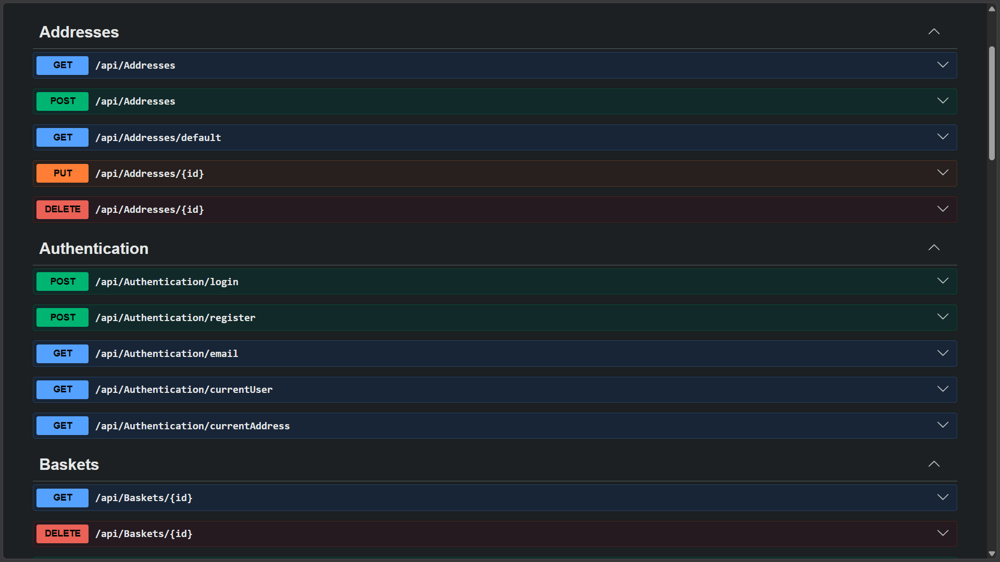
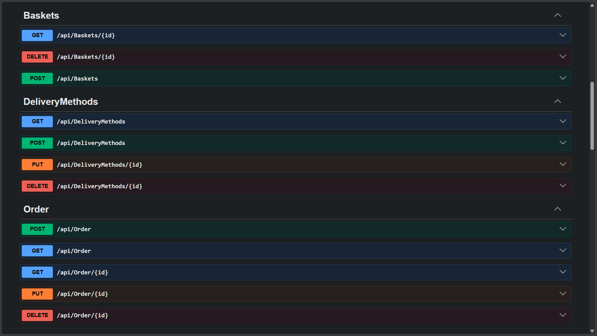
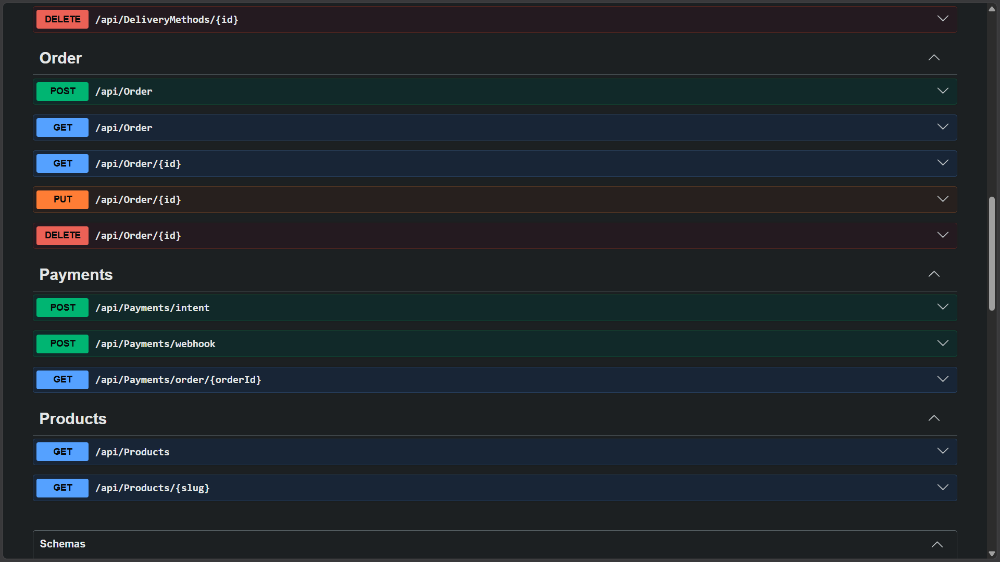
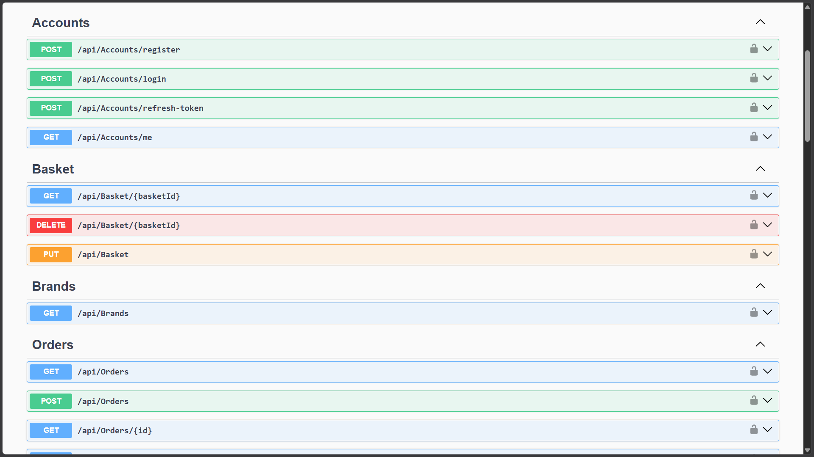
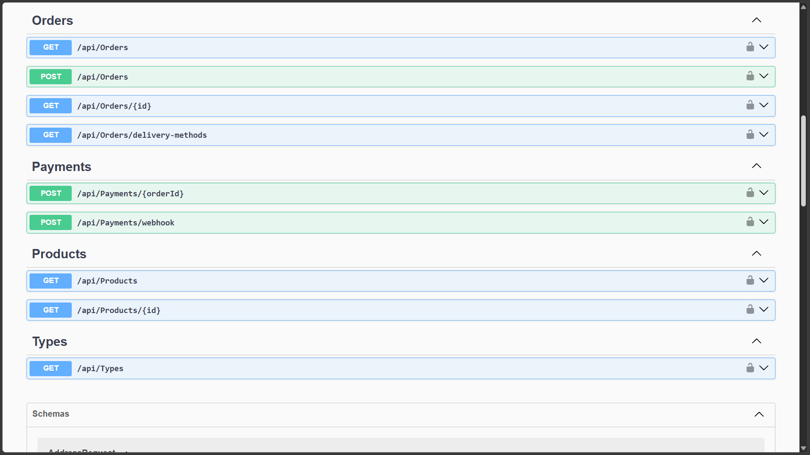

<a href="https://engmohamednowar.github.io/portfolio/"><picture><source media="(prefers-color-scheme: dark)" srcset="assets/banner-dark.svg?v=5"><source media="(prefers-color-scheme: light)" srcset="assets/banner-light.svg?v=5"></picture></a>

  <a href="https://engmohamednowar.github.io/portfolio/"><b>Portfolio</b></a> &nbsp;·&nbsp;
  <a href="https://linkedin.com/in/mohamednowar"><b>LinkedIn</b></a> &nbsp;·&nbsp;
  <a href="#-featured-projects"><b>Projects</b></a> &nbsp;·&nbsp;
  <a href="#-certifications"><b>Certifications</b></a> &nbsp;·&nbsp;
  <a href="#-where-i-work--j-servo-llc"><b>J. Servo</b></a> &nbsp;·&nbsp;
  <a href="mailto:mohamednowar2002@gmail.com"><b>Contact</b></a>

  

<picture><source media="(prefers-color-scheme: dark)" srcset="assets/stats-dark.svg?v=5"><source media="(prefers-color-scheme: light)" srcset="assets/stats-light.svg?v=5"></picture>

Figures as reported in my portfolio and project repositories.

## 🧑‍💻 About Me

**Mohamed Nowar** is a **Software Engineer at [J. Servo LLC](https://jservo.com)** and a **.NET backend developer** based in **Cairo, Egypt**. He designs and builds secure, maintainable **REST APIs with C#, ASP.NET Core, Entity Framework Core and SQL Server**, structured with **Clean Architecture, CQRS (MediatR) and the Repository / Unit of Work patterns**, and backed by automated tests in **xUnit and NSubstitute**.

His shipped work covers the full backend surface: a **.NET 10 coffee-commerce API** with Redis caching, JWT authentication and **Stripe payments with signed webhooks** (182 xUnit tests); a **full-stack accounting platform** with cookie-based auth, CSRF protection, role-based workflows and validated document uploads; e-commerce, cinema-booking and gym-management systems; and a **production-deployed WPF restaurant POS** with ESC/POS thermal printing and Arabic receipts. He holds a **B.Sc. from the Egyptian E-Learning University**, an **ASP.NET Core back-end diploma from Route Academy** and **Huawei HCIA-AI (96%)**, and is currently studying **microservices, messaging and CI/CD** in Elevate's Backend Advanced Bootcamp (.NET track).

<picture><source media="(prefers-color-scheme: dark)" srcset="assets/about-dark.svg?v=5"><source media="(prefers-color-scheme: light)" srcset="assets/about-light.svg?v=5"></picture>

<b>Quick answers</b>

 

| Question | Answer |
|---|---|
| Who is Mohamed Nowar? | A Software Engineer at J. Servo LLC and a .NET backend developer based in Cairo, Egypt. |
| What does he specialise in? | Backend REST APIs with C#, ASP.NET Core Web API, EF Core and SQL Server, using Clean Architecture and CQRS. |
| Which tools does he use? | ASP.NET Core, EF Core, LINQ, MediatR, AutoMapper, JWT, ASP.NET Identity, Redis, Stripe, Docker, Swagger, xUnit, NSubstitute, Azure DevOps, PostgreSQL, Python / Django REST Framework. |
| What has he built? | A .NET 10 coffee-store API, a full-stack accounting platform, an e-commerce API, a production WPF restaurant POS, a gym-management system and a cinema-booking API. |
| Is he available for work? | Yes: remote, hybrid and freelance backend projects. |
| How can I contact him? | [mohamednowar2002@gmail.com](mailto:mohamednowar2002@gmail.com) or [LinkedIn](https://linkedin.com/in/mohamednowar). |

## 🛠️ Tech Stack

          

      

<table>
  <tr>
    <td align="center" width="25%"><h3>🏗️ Architecture</h3>
Clean Architecture Three-layer architecture Repository pattern Unit of Work Dependency Injection CQRS &amp; MediatR OOP principles
</td>
    <td align="center" width="25%"><h3>🔐 Security</h3>
JWT authentication Cookie &amp; token auth Role-based authorization ASP.NET Core Identity CSRF protection Rate limiting
</td>
    <td align="center" width="25%"><h3>💾 Data</h3>
SQL Server PostgreSQL Redis caching EF Core &amp; LINQ Relational design Django ORM
</td>
    <td align="center" width="25%"><h3>🧪 Testing &amp; Cloud</h3>
xUnit &amp; NSubstitute Coverlet coverage Docker Azure CI/CD (Azure DevOps) Git / GitHub
</td>
  </tr>
</table>

## 🏗️ Architecture

<picture><source media="(prefers-color-scheme: dark)" srcset="assets/architecture-dark.svg?v=5"><source media="(prefers-color-scheme: light)" srcset="assets/architecture-light.svg?v=5"></picture>

## 📌 Featured Projects

<table>
  <tr>
    <td colspan="2" valign="top">
      <h3 align="center">📊 Accounting Platform — MVP</h3>
      

        
        
        
        
        
        
      

      
Full-stack accounting and client-management platform. Clients submit requests and documents; accountants and admins run a Pending → InReview → Completed workflow. HttpOnly-cookie auth with sliding sessions, role-based access (Client, Accountant, SuperAdmin), double-submit CSRF protection, OTP password reset, and magic-byte validation on every upload.

      

    </td>
  </tr>
  <tr>
    <td width="50%" valign="top">
      <h3 align="center">☕ Coffee Store API</h3>
      

        
        
        
        
        
        
        
      

      
Coffee e-commerce API on .NET 10: Clean Architecture, CQRS, Redis baskets and caching, JWT auth, and Stripe payments with signed webhooks. 182 xUnit tests, docker-compose, Swagger.

      

    </td>
    <td width="50%" valign="top">
      <h3 align="center">🛒 E-commerce API</h3>
      

        
        
        
        
      

      
RESTful e-commerce API with product catalogue, cart, orders and inventory management. JWT auth with role-based access.

      

    </td>
  </tr>
  <tr>
    <td width="50%" valign="top">
      <h3 align="center">🍽️ Restaurant POS System</h3>
      

        
        
        
        
      

      
Production-deployed desktop POS with ESC/POS thermal printing, Arabic receipt support and Win32 API integration.

      

    </td>
    <td width="50%" valign="top">
      <h3 align="center">✅ My Tasks — Todo App</h3>
      

        
        
        
        
        
      

      
Notion-style task manager with sub-tasks, recurring tasks, Pomodoro timer, dashboard and theming. MVVM + Repository pattern, 50 unit tests.

      

    </td>
  </tr>
  <tr>
    <td width="50%" valign="top">
      <h3 align="center">🏋️ Gym Management System</h3>
      

        
        
        
        
      

      
Gym management with member tracking, trainer scheduling, session booking and the full membership lifecycle.

      

    </td>
    <td width="50%" valign="top">
      <h3 align="center">🎬 Cinema Ticket Reservation API</h3>
      

        
        
        
      

      
Movie schedules, seat selection and ticket booking API with JWT auth and role-based permissions.

      

    </td>
  </tr>
</table>

## 📱 Screenshots

### ☕ Coffee Store API — Swagger

<table>
  <tr>
    <td align="center"><strong>Addresses · Authentication · Baskets</strong> </td>
    <td align="center"><strong>Baskets · Delivery Methods · Order</strong> </td>
  </tr>
  <tr>
    <td align="center"><strong>Order · Payments · Products</strong> </td>
    <td align="center"><strong>8 controllers</strong> Auth · Catalogue · Baskets · Orders · Stripe Payments · Addresses · Delivery  </td>
  </tr>
</table>

### 🛒 E-commerce API — Swagger

<table>
  <tr>
    <td align="center"><strong>Accounts · Basket · Brands · Orders</strong> </td>
    <td align="center"><strong>Orders · Payments · Products · Types</strong> </td>
  </tr>
</table>

### ✅ My Tasks — Todo App

<table>
  <tr>
    <td align="center"><strong>Main view</strong> </td>
    <td align="center"><strong>Dashboard</strong> </td>
  </tr>
</table>

### 🏋️ Gym Management System

<table>
  <tr>
    <td align="center"><strong>Home page</strong> </td>
    <td align="center"><strong>Admin dashboard</strong> </td>
  </tr>
</table>

### 🍕 Restaurant POS System

<table>
  <tr>
    <td align="center"><strong>POS admin</strong> </td>
    <td align="center"><strong>Daily report</strong> </td>
  </tr>
</table>

## 📊 GitHub Stats

Self-hosted cards, regenerated every 6 hours by <a href=".github/workflows/stats.yml">a GitHub Action</a>.

  

<picture>
  <source media="(prefers-color-scheme: dark)" srcset="https://raw.githubusercontent.com/EngMohamedNowar/EngMohamedNowar/output/github-snake-dark.svg">
  <source media="(prefers-color-scheme: light)" srcset="https://raw.githubusercontent.com/EngMohamedNowar/EngMohamedNowar/output/github-snake.svg">
  
</picture>

## 🎓 Certifications

<table>
  <tr>
    <td width="50%" align="center"></td>
    <td width="50%" align="center"></td>
  </tr>
  <tr>
    <td width="50%" align="center"></td>
    <td width="50%" align="center"></td>
  </tr>
  <tr>
    <td width="50%" align="center"></td>
    <td width="50%" align="center"></td>
  </tr>
  <tr>
    <td width="50%" align="center"></td>
    <td width="50%" align="center"></td>
  </tr>
</table>

## 🤝 Where I work — J. Servo LLC

I'm a Software Engineer at **[J. Servo LLC](https://jservo.com)**, a technology company in New Cairo, Egypt, that builds practical business solutions and integrated AI modules for small and mid-size businesses and startups. Independent reviews and verified listings for the company:

  <a href="https://www.trustpilot.com/review/jservo.com" title="J. SERVO reviews on Trustpilot"><picture><source media="(prefers-color-scheme: dark)" srcset="assets/trust/trustpilot-dark.svg?v=5"><source media="(prefers-color-scheme: light)" srcset="assets/trust/trustpilot-light.svg?v=5"></picture></a>
  <a href="https://clutch.co/profile/j-servo" title="J. SERVO reviews on Clutch"><picture><source media="(prefers-color-scheme: dark)" srcset="assets/trust/clutch-dark.svg?v=5"><source media="(prefers-color-scheme: light)" srcset="assets/trust/clutch-light.svg?v=5"></picture></a>
  <a href="https://www.goodfirms.co/company/j-servo-llc" title="J. SERVO reviews on GoodFirms"><picture><source media="(prefers-color-scheme: dark)" srcset="assets/trust/goodfirms-dark.svg?v=5"><source media="(prefers-color-scheme: light)" srcset="assets/trust/goodfirms-light.svg?v=5"></picture></a>

  <a href="https://techbehemoths.com/company/j-servo-llc" title="J. SERVO verified profile on TechBehemoths"><picture><source media="(prefers-color-scheme: dark)" srcset="assets/trust/techbehemoths-dark.svg?v=5"><source media="(prefers-color-scheme: light)" srcset="assets/trust/techbehemoths-light.svg?v=5"></picture></a>
  <a href="https://www.sortlist.com/agency/jservo" title="J. SERVO agency profile on Sortlist"><picture><source media="(prefers-color-scheme: dark)" srcset="assets/trust/sortlist-dark.svg?v=5"><source media="(prefers-color-scheme: light)" srcset="assets/trust/sortlist-light.svg?v=5"></picture></a>
  <a href="https://www.f6s.com/company/j-servo" title="J. SERVO company profile on F6S"><picture><source media="(prefers-color-scheme: dark)" srcset="assets/trust/f6s-dark.svg?v=5"><source media="(prefers-color-scheme: light)" srcset="assets/trust/f6s-light.svg?v=5"></picture></a>

  <a href="https://www.wikidata.org/wiki/Q141189697" title="J. SERVO on Wikidata (Q141189697)"><picture><source media="(prefers-color-scheme: dark)" srcset="assets/trust/wikidata-dark.svg?v=5"><source media="(prefers-color-scheme: light)" srcset="assets/trust/wikidata-light.svg?v=5"></picture></a>

## 📫 Let's Connect

 

 

<picture><source media="(prefers-color-scheme: dark)" srcset="assets/footer-dark.svg?v=5"><source media="(prefers-color-scheme: light)" srcset="assets/footer-light.svg?v=5"></picture>

Artwork set in <a href="https://fonts.google.com/specimen/Syne">Syne</a> &amp; Syne Mono (SIL Open Font License) · brand palette <code>#804199</code> · <code>#20AACF</code> · generated by <a href="scripts/build_profile.py">scripts/build_profile.py</a>

